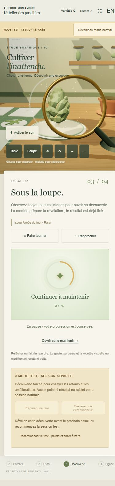

# Table de R&D — V02.1, essai rapide

Une démo autonome pour choisir deux parents, obtenir un descendant, l’examiner en 3D puis faire progresser sa lignée. Préparée le 9 novembre 2026 pour **Au four, mon amour**, avant intégration Unity. V01 reste conservée séparément.

[Mode test : découvertes garanties](https://nobletsylvain.github.io/prototypes/table-rd-v02/?mode=test) · [Mode normal : chances inchangées](https://nobletsylvain.github.io/prototypes/table-rd-v02/)

## Essayer rapidement la recherche

Le **mode test** prépare un descendant rare ou exceptionnel garanti pour comparer révélation, points de recherche, améliorations, sons et effets sans attendre un tirage favorable. Le résultat forcé est un outil d’essai : il ne représente pas la chance annoncée en mode normal.

Le test possède son carnet, ses points et sa sauvegarde séparés. Rien ne passe vers la session normale. Au premier accès, le lien de test place une rare directement sous la loupe. Le bandeau permet de revenir au mode normal ; les commandes de test se trouvent après le panneau principal.

Après révélation, **Préparer une rare / exceptionnelle** archive la découverte affichée si nécessaire et conserve les points du test. Un résultat encore caché doit être révélé avant ce nouvel essai. **Recommencer le test** crée une rare à examiner, avec points et choix à zéro, pour comparer les voies opposées. Ce reset touche uniquement le test. Le carnet et les fiches exportées signalent leur origine de test.

Les points arrivent uniquement lorsque le résultat est révélé, une fois pour chacun des deux parents. Préparer la scène ou commencer le geste de révélation ne crédite rien.

## La boucle

Choisir les parents → prélever les boutures nécessaires → engager une petite production → observer l’objet sous la loupe → révéler sa fiche → conserver et nommer → réutiliser la découverte comme parent.

Les calques choisissant directement les traits ont été retirés. Les parents et leur recherche orientent les probabilités de démonstration. Le résultat est fixé à l’engagement : recharger ou mieux manipuler ne le change pas.

Une découverte rare ou exceptionnelle donne **un point à chacun de ses deux parents, une seule fois**. Ces points servent à des choix exclusifs propres à chaque variété. Ils ne réécrivent ni son profil génétique ni les lots antérieurs.

## Commandes

Vue à la première personne. Poser les fiches et engager l’essai avec les boutons. Sous la loupe, glisser pour tourner/regarder et utiliser les boutons pour rapprocher le spécimen. Les points blancs ouvrent Héritage, Résonance et Origine. La fiche vient après l’examen. Avant d’acheter une voie, consulter la comparaison chiffrée avec le parent indiqué.

Pour révéler, maintenir la commande environ **1,5 seconde**. Relâcher met en pause sans faire perdre l’avancement de la séquence en cours. Une commande clavier et une option assistée en un clic permettent la même révélation. Cette durée sert le ressenti : vitesse, précision et interruptions ne changent ni le résultat déjà fixé ni les points.

Activer le son à la demande. **Expressif** et **Discret** comparent les retours du même état ; le volume se règle séparément. Dans le test, les commandes **Rejouer** répètent les sons et effets d’une découverte révélée ou d’une amélioration acquise, sans créditer de point ni modifier l’état. Aucune précision motrice ne modifie ressources, points ou résultat.

## Paramètres et limites

Profils, rareté, probabilités, budgets de prélèvement, branches, coûts, durée accélérée et retours sont proposés pour cet essai. Ils ne fixent pas les recettes des autres produits ou les emplacements de spécialisation.

Identité, lot et goûts d’une clientèle restent distincts. Les boutures sont physiques et identifiées ; un pot est occupé puis libéré. La sauvegarde locale conserve l’essai dans ce navigateur sans synchronisation entre appareils. Une nouvelle session explicite réinitialise la démo.

Le moteur de règles du mode normal est conservé à l’identique, octet pour octet. **47 tests réussis, 0 échec** : 27 contrôles des règles V02, 14 sur la préparation forcée et 6 sur le maintien cumulatif. Les sept modules embarqués passent le contrôle de syntaxe. **11 contrôles audio avec contexte simulé réussissent** séparément, sans constituer une écoute validée.

**V02.1 publiée : parcours vérifié dans le navigateur.** Un maintien de 600 ms a atteint 40 %, conservés après plusieurs minutes de pause ; une reprise de 1100 ms a révélé une rare et crédité un point à chaque parent. Convergence a été acquise pour Aube, avec l’alternative exclue. Rejouer découverte ou amélioration n’a changé aucun compteur. Une exceptionnelle ouverte avec l’assistance a apporté le second point parental ; le gain et l’achat ont persisté au rechargement. Le retour au mode normal a retrouvé exactement le panneau témoin. Le reset du test a préparé une nouvelle rare à examiner.

Dans un format navigateur de 390 × 844, la disposition passe à la verticale sans débordement horizontal mesuré. Un appui souris de 550 ms y a laissé la révélation en pause à 37 %. La capture ci-dessous a été regardée. Aucune erreur ou alerte console n’a été relevée sur le parcours. Ce format simulé ne constitue pas un essai sur téléphone physique.

**Historique V02 avant cet ajout :** les cinq modules du fichier publié ont passé le contrôle de syntaxe. Les événements sonores ont été contrôlés avec un contexte simulé ; le cadrage des points blancs a été vérifié par projection sur six largeurs de 390 à 1440 px.

Ce premier lien V02 a été vérifié dans un navigateur : choix parental, chances, engagement, loupe avant fiche, découverte ordinaire, nom, conservation, prélèvement et reprise de la descendante comme parent. Les chances rares observées sont passées de 20 % pour les deux fondatrices à 32 % pour la paire suivante, avec 78 % d’affinité. La vue à 390 × 844, les points blancs et une amélioration verrouillée ont été parcourus sans erreur ou alerte console relevée. Ce parcours historique précède le mode test et le maintien de révélation ; les vérifications V02.1 sont rapportées séparément ci-dessus.

Aucun essai humain, test sur téléphone physique, écoute validée ou intégration Unity n’est revendiqué.

[Ouvrir la démo V02](https://nobletsylvain.github.io/prototypes/table-rd-v02/) · [V01 conservée](https://nobletsylvain.github.io/prototypes/table-rd-v01/).

Le spécimen utilise un modèle visuel partagé : son éclairage et sa signature varient, pas une nouvelle géométrie par lignée. Les sons sont synthétisés localement. Three.js est fourni sous licence MIT, incluse dans ce dossier.

[Passation Unity](handoff/PASSATION_UNITY.md) · [Sons provisoires](handoff/AUDIO.md)
