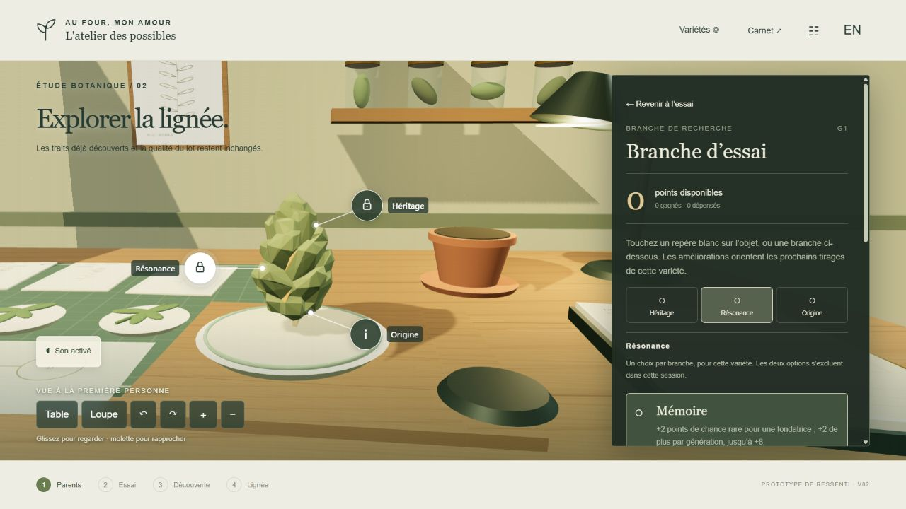

# Table de R&D — V02

Une démo autonome pour choisir deux parents, obtenir un descendant, l’examiner en 3D puis faire progresser sa lignée. Préparée le 9 novembre 2026 pour **Au four, mon amour**, avant intégration Unity. V01 reste conservée séparément.

## La boucle

Choisir les parents → prélever les boutures nécessaires → engager une petite production → observer l’objet sous la loupe → révéler sa fiche → conserver et nommer → réutiliser la découverte comme parent.

Les calques choisissant directement les traits ont été retirés. Les parents et leur recherche orientent les probabilités de démonstration. Le résultat est fixé à l’engagement : recharger ou mieux manipuler ne le change pas.

Une découverte rare ou exceptionnelle donne **un point à chacun de ses deux parents, une seule fois**. Ces points servent à des choix exclusifs propres à chaque variété. Ils ne réécrivent ni son profil génétique ni les lots antérieurs.

## Commandes

Vue à la première personne. Poser les fiches et engager l’essai avec les boutons. Sous la loupe, glisser pour tourner/regarder et utiliser les boutons pour rapprocher le spécimen. Les points blancs ouvrent Héritage, Résonance et Origine. La fiche vient après l’examen. Avant d’acheter une voie, consulter la comparaison chiffrée avec le parent indiqué.

Activer le son à la demande. **Expressif** et **Discret** comparent les retours du même état ; le volume se règle séparément. Aucune précision motrice ne modifie ressources, points ou résultat.

## Paramètres et limites

Profils, rareté, probabilités, budgets de prélèvement, branches, coûts, durée accélérée et retours sont proposés pour cet essai. Ils ne fixent pas les recettes des autres produits ou les emplacements de spécialisation.

Identité, lot et goûts d’une clientèle restent distincts. Les boutures sont physiques et identifiées ; un pot est occupé puis libéré. La sauvegarde locale conserve l’essai dans ce navigateur sans synchronisation entre appareils. Une nouvelle session explicite réinitialise la démo.

**Modèle V02 : 27 tests réussis, 0 échec**, couvrant plusieurs générations, les ressources physiques, les seuils de rareté, les points uniques, les exclusions, l’identité et les rechargements. Ce sont des contrôles du modèle ; ils ne valident pas le rendu ou le plaisir.

Les cinq modules du fichier publié passent le contrôle de syntaxe. Les événements sonores ont été contrôlés avec un contexte simulé ; le cadrage des points blancs a été vérifié par projection sur six largeurs de 390 à 1440 px.

Le lien publié a ensuite été vérifié dans un navigateur : choix parental, chances, engagement, loupe avant fiche, découverte ordinaire, nom, conservation, prélèvement et reprise de la descendante comme parent. Les chances rares observées sont passées de 20 % pour les deux fondatrices à 32 % pour la paire de génération suivante, avec une affinité de 78 %. La vue à 390 × 844, les repères blancs et la prévisualisation d’une amélioration verrouillée ont été parcourus ; aucune erreur ou alerte console relevée. Les gains rares et achats effectifs sont couverts par les tests du modèle, pas par ce parcours navigateur.

Aucun essai humain, test sur téléphone physique, écoute validée ou intégration Unity n’est revendiqué.

[Ouvrir la démo V02](https://nobletsylvain.github.io/prototypes/table-rd-v02/) · [V01 conservée](https://nobletsylvain.github.io/prototypes/table-rd-v01/).

Le spécimen utilise un modèle visuel partagé : son éclairage et sa signature varient, pas une nouvelle géométrie par lignée. Les sons sont synthétisés localement. Three.js est fourni sous licence MIT, incluse dans ce dossier.

[Passation Unity](handoff/PASSATION_UNITY.md) · [Sons provisoires](handoff/AUDIO.md)
